# TÀI LIỆU ĐỀ XUẤT GIẢI PHÁP KỸ THUẬT RAG PIPELINE
## (Retrieval-Augmented Generation với Gemini API & Vector Database)

- **Mã Task:** SCRUM-7
- **Đề tài:** Mạng xã hội chia sẻ tài liệu học thuật phi tập trung (Kiểu StuDocu)
- **Tác giả / Nghiên cứu:** AI & Backend System Team
- **Ngày hoàn thành:** Tháng 9/2026

---

## 1. ĐẶT VẤN ĐỀ VÀ BỐI CẢNH DỰ ÁN

Trên nền tảng chia sẻ tài liệu học thuật như StuDocu, sinh viên phải tiếp cận các tập tài liệu rất dài (Slide bài giảng 100–200 trang, Giáo trình 300–500 trang, Đề thi tổng hợp). Sinh viên thường gặp khó khăn:
1. Mất thời gian đọc lướt để tìm một định nghĩa, công thức, hoặc bài tập cụ thể.
2. Các chatbot thông thường (như ChatGPT mặc định) gặp hiện tượng **Ảo giác (Hallucination)**, không thể biết nội dung giáo trình riêng biệt của từng trường đại học (như PTIT, Bách Khoa, KHTN).
3. Người học cần biết chính xác thông tin được lấy từ **trang nào, tài liệu nào** để kiểm chứng.

**Giải pháp:** Xây dựng tính năng **AI Assistant (RAG Chatbot)** ngay bên cạnh màn hình xem PDF:
- Khi người dùng xem tài liệu hoặc vào trang môn học, họ có thể hỏi bằng ngôn ngữ tự nhiên.
- Hệ thống trích xuất nội dung liên quan nhất từ tài liệu, gửi kèm câu hỏi cho **Gemini API**.
- Gemini API trả lời súc tích và trả về danh sách thẻ nguồn **"Sources Found"** (kèm số trang, trích dẫn ngắn và đường link nhảy thẳng tới trang đó).

---

## 2. LUỒNG HOẠT ĐỘNG TOÀN DIỆN CỦA RAG PIPELINE

Quy trình RAG của hệ thống được chia làm 2 giai đoạn độc lập:

```mermaid
flowchart TD
    subgraph INGESTION_PIPELINE ["1. Luồng Nạp Dữ liệu (Offline / Async Worker)"]
        A[File PDF Sinh viên Upload] --> B[Trích xuất Text & OCR - SCRUM-12]
        B --> C[Làm sạch & Chuẩn hóa Unicode]
        C --> D[Bộ chia khối - Academic Chunker]
        D --> E[Gemini text-embedding-004]
        E --> F[Lưu Vector & Metadata vào PostgreSQL/pgvector]
    end

    subgraph QUERY_PIPELINE ["2. Luồng Hỏi Đáp Trực tuyến (Online Chat)"]
        G[Sinh viên gửi câu hỏi trên Chat UI] --> H[Backend API Service]
        H --> I[Gemini text-embedding-004 tạo Query Vector]
        I --> J[PostgreSQL pgvector: Cosine Similarity + Metadata Filter]
        J --> K[Top K Chunks phù hợp nhất]
        K --> L[Xây dựng Augmented Prompt + JSON Schema]
        L --> M[Gemini 1.5 Flash - Structured Output]
        M --> N[Trả về JSON: Answer + Sources Found Cards]
        N --> O[Frontend hiển thị câu trả lời & liên kết tới PDF]
    end
```



### 2.1. Luồng Nạp Dữ Liệu (Data Ingestion Pipeline - Async)
1. **Tiếp nhận & Trích xuất:** Khi sinh viên upload file PDF lên MinIO/IPFS, tác vụ trích xuất (SCRUM-12) được kích hoạt qua RabbitMQ.
2. **Chunking (Cắt khúc thông minh):** Phân chia văn bản thành các phân đoạn nhỏ có độ dài phù hợp.
3. **Embedding:** Gửi từng chunk tới `text-embedding-004` để lấy vector đặc trưng (768 chiều).
4. **Indexing:** Lưu vector cùng metadata (`document_id`, `page_number`, `chunk_content`, `university_id`, `faculty_id`) vào PostgreSQL.

### 2.2. Luồng Truy Vấn (Online Query Pipeline)
1. **User Query:** Sinh viên hỏi: *"Đặc điểm của tính kế thừa trong Java là gì?"* khi đang xem slide môn Lập trình hướng đối tượng.
2. **Embed Query:** Backend chuyển câu hỏi thành vector embedding 768 chiều.
3. **Vector Similarity Search:** Truy vấn các chunk có khoảng cách Cosine nhỏ nhất trong cơ sở dữ liệu, kết hợp bộ lọc:
   - Chỉ tìm trong tài liệu hiện tại (`document_id = '...'`) HOẶC trong cùng môn học (`course_id = 'CS101'`).
   - Lọc theo quyền truy cập của người dùng (chỉ tìm trong các trang Free Preview hoặc tài liệu đã unlock).
4. **Context Injection:** Đưa các chunk trích xuất vào System Prompt của Gemini.
5. **Generation & Verification:** Gemini phân tích ngữ cảnh, trả lời và xuất ra cấu trúc JSON chuẩn gồm câu trả lời và trích dẫn.

---

## 3. SO SÁNH & QUYẾT ĐỊNH LỰA CHỌN VECTOR DATABASE

Chúng tôi đã tiến hành đánh giá 4 giải pháp Vector Database phổ biến nhất hiện nay dựa trên Tech Stack của dự án (PostgreSQL, Docker/K8s, Go/FastAPI, Next.js):

| Tiêu chí Đánh giá | PostgreSQL + `pgvector` ⭐ (Được chọn) | ChromaDB (Phương án Dev) | Qdrant | Pinecone (Cloud) |
| :--- | :--- | :--- | :--- | :--- |
| **Loại hình** | Extension tích hợp vào PostgreSQL | CSDL Vector nhúng / Standalone | Vector DB chuyên dụng (Rust) | Fully Managed Cloud Vector DB |
| **Bản quyền & Chi phí** | Mã nguồn mở (Miễn phí 100%) | Mã nguồn mở (Miễn phí) | Mã nguồn mở (Apache 2.0) | Đóng, trả phí theo số vector/pod |
| **Sự phù hợp Tech Stack** | **Tuyệt đối 100%**: Dự án đã có sẵn PostgreSQL | Tốt cho Python, khó tích hợp Go | Cần thêm 1 container riêng | Cần internet ra ngoài, phụ thuộc vendor |
| **Truy vấn hỗn hợp (Hybrid Query)** | **Vượt trội**: JOIN trực tiếp bảng `documents`, `users`, `courses`, `permissions` trong 1 query SQL | Kém: Phải lọc metadata thô trong memory hoặc query phụ | Khá tốt qua Payload filter | Khá, nhưng độ linh hoạt SQL bằng 0 |
| **Chỉ mục Vector (Index)** | HNSW (Hierarchical Navigable Small World) & IVFFlat | HNSW | HNSW | Proprietary HNSW |
| **Khả năng chịu tải (Dataset Đồ án)** | Hỗ trợ mượt mà từ 100.000 đến 10.000.000 chunks với RAM hợp lý | Thích hợp < 100.000 chunks (Local dev) | Rất mạnh khi scale lớn | Cực mạnh nhưng tốn tiền |
| **Độ tin cậy (ACID)** | Chuẩn Enterprise ACID của PostgreSQL | Không hỗ trợ ACID hoàn chỉnh | ACID cơ bản | Managed |

### 🎯 Quyết định Chốt:
1. **Môi trường Production / Docker chung của nhóm:** Sử dụng **`PostgreSQL + pgvector`** (Docker image: `pgvector/pgvector:pg16`).
   - *Lý do then chốt:* Không phát sinh thêm một service độc lập làm phức tạp Kubernetes/Docker Compose; Đảm bảo tính nhất quán dữ liệu (khi xóa một tài liệu trong bảng `documents`, lệnh `ON DELETE CASCADE` tự động dọn sạch toàn bộ Vector chunks tương ứng); Lọc quyền truy cập và kiểm tra sinh viên có được xem trang đó hay không ngay trong mệnh đề `WHERE` của SQL.
2. **Môi trường Nghiên cứu độc lập của AI Engineer:** Hỗ trợ dùng tạm **ChromaDB** hoặc in-memory cosine để viết nhanh script kiểm thử mô hình trước khi đẩy sang PostgreSQL.

---

## 4. CHIẾN LƯỢC CẮT KHỐI TÀI LIỆU (CHUNKING STRATEGY)

Tài liệu học thuật có cấu trúc rất đặc thù:
- **Slide bài giảng:** Chứa ít chữ, nhiều gạch đầu dòng, tiêu đề slide mang tính ngữ cảnh cao.
- **Giáo trình / Đề cương:** Chứa các đoạn văn dài, công thức, ví dụ code lồng nhau.

### 4.1. Quy tắc Cắt khối Phân cấp (Recursive Character Splitter)
- **Kích thước Chunk (Chunk Size):** `600 - 800` ký tự (tương đương `150 - 200` tokens).
- **Độ gối đầu (Chunk Overlap):** `100 - 150` ký tự. Giúp giữ trọn vẹn ngữ nghĩa khi một định nghĩa hoặc công thức toán học bị ngắt ngang giữa 2 đoạn.
- **Dãy ký tự phân tách ưu tiên:** `["\n\n", "\n", ". ", "; ", " ", ""]`.

### 4.2. Contextual Chunking (Bảo tồn Ngữ cảnh Môn học & Trang)
Mỗi chunk trước khi đem đi sinh vector embedding sẽ được đính kèm phần tiền tố ngữ cảnh (Context Header):
```text
[Tài liệu: Lập trình hướng đối tượng | Môn: CS101 | Trường: PTIT | Trang: 15]
Nội dung trích xuất:
Tính đa hình (Polymorphism) cho phép một đối tượng có thể biểu diễn dưới nhiều hình thái khác nhau...
```
*Tác dụng:* Giúp vector embedding nắm được chính xác chủ đề môn học, tránh nhầm lẫn khái niệm giữa các ngành khác nhau (ví dụ: "Bộ nhớ" trong Kiến trúc máy tính vs "Bộ nhớ" trong Tâm lý học đại cương).

---

## 5. TÍCH HỢP GEMINI API: EMBEDDING & STRUCTURED OUTPUT

### 5.1. Model Lựa chọn
- **Embedding:** `models/text-embedding-004`
  - Output dimension: 768 dimensions.
  - Hỗ trợ tốt đa ngôn ngữ (đặc biệt là tiếng Việt chuyên ngành).
- **Generation:** `models/gemini-1.5-flash` hoặc `models/gemini-2.5-flash`
  - Tốc độ sinh text cực nhanh (< 1.5 giây).
  - Giá thành rất tiết kiệm.
  - Hỗ trợ **Structured Outputs** (buộc mô hình trả lời tuân thủ nghiêm ngặt theo JSON Schema).

### 5.2. Kỹ thuật Enforced Structured Output
Để giao diện Frontend hiển thị được thẻ trích dẫn tài liệu như StuDocu, Backend truyền cấu trúc Pydantic Schema vào cấu hình `response_schema` của Gemini API.

```python
from pydantic import BaseModel, Field
from typing import List

class SourceFound(BaseModel):
    document_id: str = Field(description="Mã định danh của tài liệu")
    document_title: str = Field(description="Tên của tài liệu")
    page_number: int = Field(description="Số trang chứa thông tin này")
    quote_snippet: str = Field(description="Đoạn trích dẫn nguyên văn ngắn làm bằng chứng")
    relevance_score: float = Field(description="Độ tương quan (0.0 đến 1.0)")

class AcademicChatResponse(BaseModel):
    answer_markdown: str = Field(description="Câu trả lời giải thích chi tiết bằng Markdown")
    confidence_level: str = Field(description="Mức độ tự tin: HIGH, MEDIUM, LOW")
    sources_found: List[SourceFound] = Field(description="Danh sách các nguồn trích dẫn")
    suggested_followup_questions: List[str] = Field(description="2-3 câu hỏi gợi ý tiếp theo")
```

---

## 6. THIẾT KẾ SCHEMA CSDL POSTGRESQL (DÀNH CHO BACKEND)

```sql
-- Kích hoạt extension pgvector
CREATE EXTENSION IF NOT EXISTS vector;

-- Bảng lưu trữ từng đoạn văn bản đã cắt nhỏ và vector embedding tương ứng
CREATE TABLE IF NOT EXISTS document_chunks (
    chunk_id UUID PRIMARY KEY DEFAULT gen_random_uuid(),
    document_id VARCHAR(64) NOT NULL,
    page_number INT NOT NULL,
    chunk_index INT NOT NULL,
    content TEXT NOT NULL,
    char_count INT NOT NULL,
    token_count INT,
    embedding vector(768) NOT NULL, -- 768 chiều tương thích text-embedding-004
    created_at TIMESTAMP WITH TIME ZONE DEFAULT CURRENT_TIMESTAMP,
    
    -- Khóa ngoại liên kết tới bảng documents nghiệp vụ
    CONSTRAINT fk_document FOREIGN KEY (document_id) REFERENCES documents(id) ON DELETE CASCADE
);

-- Tạo Index HNSW để tăng tốc độ tìm kiếm tương đồng vector (Similarity Search)
CREATE INDEX IF NOT EXISTS idx_document_chunks_embedding_hnsw 
ON document_chunks 
USING hnsw (embedding vector_cosine_ops)
WITH (m = 16, ef_construction = 64);

-- Index phụ phục vụ lọc nhanh theo tài liệu hoặc trang
CREATE INDEX IF NOT EXISTS idx_document_chunks_doc_page 
ON document_chunks (document_id, page_number);
```

### Câu truy vấn Similarity Search chuẩn có lọc Metadata:
```sql
SELECT 
    chunk_id,
    document_id,
    page_number,
    content,
    1 - (embedding <=> $1::vector) AS cosine_similarity
FROM document_chunks
WHERE document_id = $2 -- Hoặc lọc theo danh sách tài liệu được phép xem
ORDER BY embedding <=> $1::vector
LIMIT 5;
```

---

## 7. BẢO MẬT & PHÂN QUYỀN TRUY XUẬT TRONG RAG (ABAC TÍCH HỢP)

Một vấn đề quan trọng trong đồ án chia sẻ tài liệu là **Bản quyền & Giới hạn quyền xem (SCRUM-14)**:
- Nếu sinh viên chưa mở khóa (Unlock) tài liệu, họ chỉ được xem thử 3 trang đầu (`free_pages: 3`).
- **Nguyên tắc an toàn RAG:** AI Chatbot **tuyệt đối không được leak** nội dung của các trang bị khóa nếu người dùng chưa trả phí/chưa upload tài liệu để mở khóa.
- **Cơ chế triển khai:** Khi thực hiện câu lệnh Vector Search, Backend bổ sung điều kiện lọc:
  ```sql
  WHERE (document_id = :doc_id AND (page_number <= :free_pages OR :user_has_unlocked = TRUE))
  ```
  Điều này ngăn chặn triệt để nguy cơ người dùng dùng prompt injection ("Hãy đọc toàn bộ trang 10 và tóm tắt cho tôi") để bypass cơ chế tính phí!
